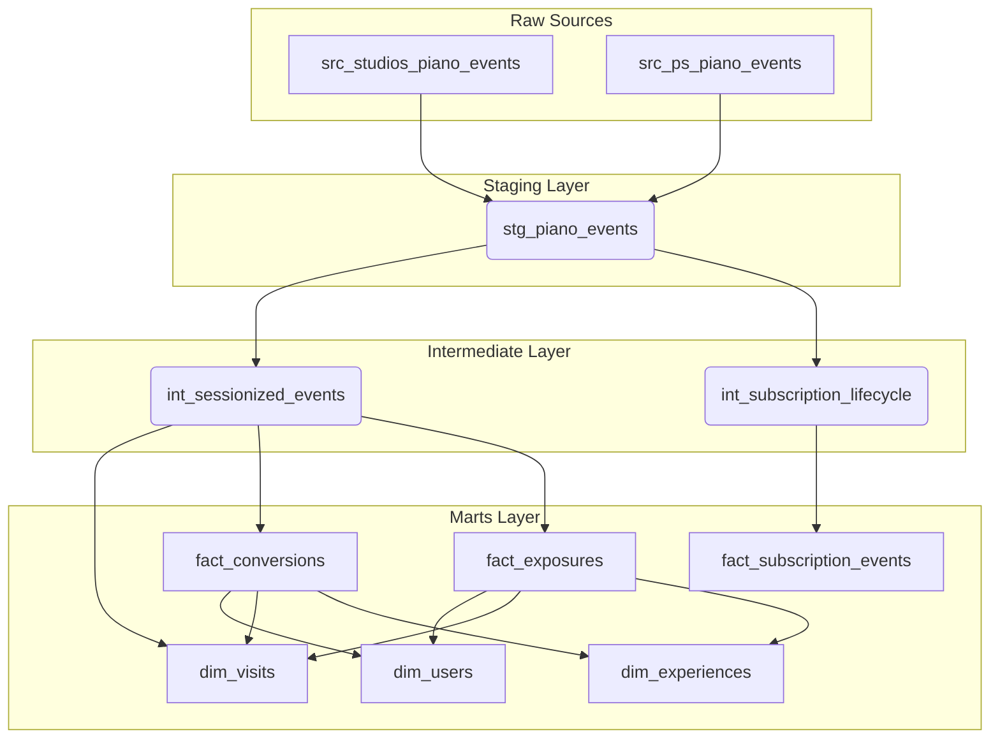
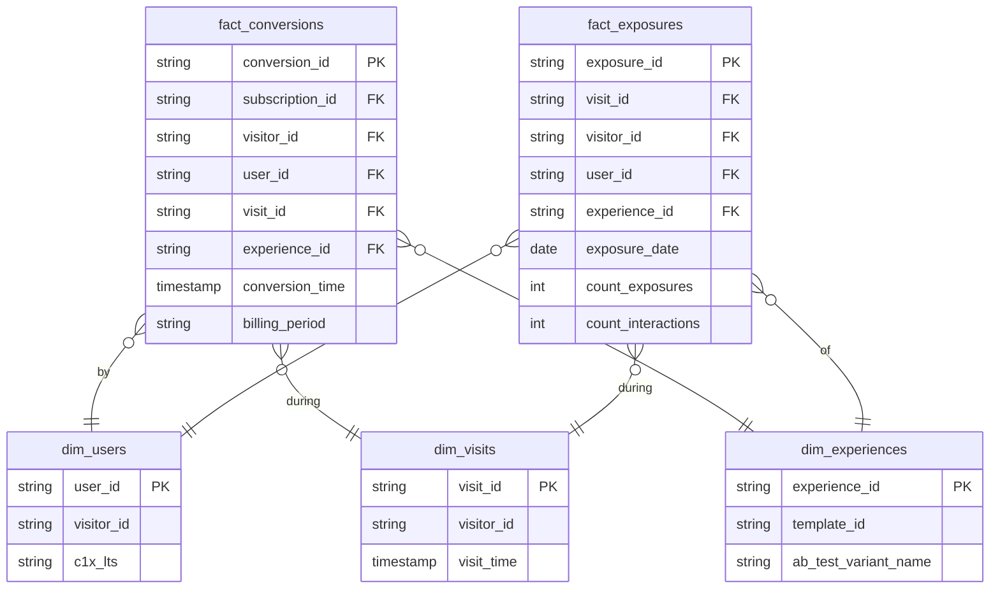

# DNS Transformations Project - Transformations

This repository contains the dbt project for transforming Piano analytics data into a structured dimensional model, ready for analysis. The primary goal is to model user behavior, subscription events, and exposure to on-site experiences.

## 📈 The Data Model

This dbt project follows a layered data modeling approach to systematically progress data from its raw source format to clean, well-documented, and analysis-ready tables.

The layers are organized as follows:

1.  **Staging (`models/staging`)**: Models in this layer perform light-touch cleaning of the source data. This includes column renaming, type casting, and basic transformations to create a consistent foundation for downstream models. Each staging model generally corresponds to a single source table.

2.  **Intermediate (`models/intermediate`)**: This layer contains more complex transformations. Models here often join multiple staging models, apply business logic, and aggregate data to create building blocks for the final mart tables. For example, user sessions might be reconstructed here.

3.  **Marts (`models/marts`)**: These are the final, user-facing models. They are designed for specific business purposes and are structured as fact and dimension tables. These tables are what data consumers (analysts, data scientists, BI tools) will query directly.

### Data Flow Diagram

Here is a high-level overview of the data flow through the dbt project:

### Dimensional Model

The marts layer is organized as a dimensional model to facilitate analytics on key business processes. The core components are fact tables, which store events and metrics, and dimension tables, which provide descriptive context.

#### Fact Tables

- `fact_conversions`: An event-based fact table where each row represents a single subscription conversion. It captures key details about the conversion, such as the promo code used, billing period, and the Composer experience that drove it.
- `fact_exposures`: A daily snapshot fact table that aggregates user exposures to Composer experiences. It counts the number of times a user was exposed to or interacted with a specific A/B test variant on a given day.
- `fact_subscription_events`: An event-based fact table that logs the entire lifecycle of a subscription. It includes events like 'New Subscription', 'Canceled', and 'Expired', which is crucial for churn and survival analysis.

#### Dimension Tables

While not explicitly defined in the provided files, the fact tables are designed to be joined with dimension tables such as:

- `dim_users`: Contains information about registered users.
- `dim_visits`: Contains details about a user's visit (session), such as start time and landing page.
- `dim_experiences`: A dimension for Composer experiences, containing details about the experience, template, and A/B test variant.

### Marts Schema Diagram

The relationship between the core fact and dimension tables can be visualized as a star schema.

## 🔬 Analyses

The `analyses/` directory contains exploratory queries and scripts that leverage the mart tables. An example is `survival_data.sql`, which uses `fact_subscription_events` to prepare data for a subscriber survival analysis, calculating tenure duration and churn status for each subscription.

## ⚙️ Development

To run this dbt project locally, ensure you have a `profiles.yml` file configured for your Snowflake connection. Refer to the dbt documentation for setup instructions.

Key commands:

- `dbt run`: Executes all models.
- `dbt test`: Runs all data and schema tests.
- `dbt build`: Runs models and tests.
