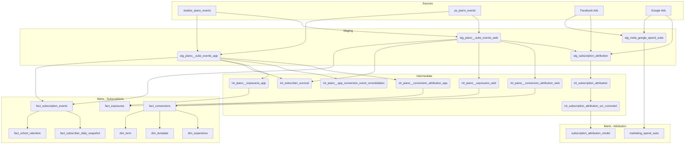
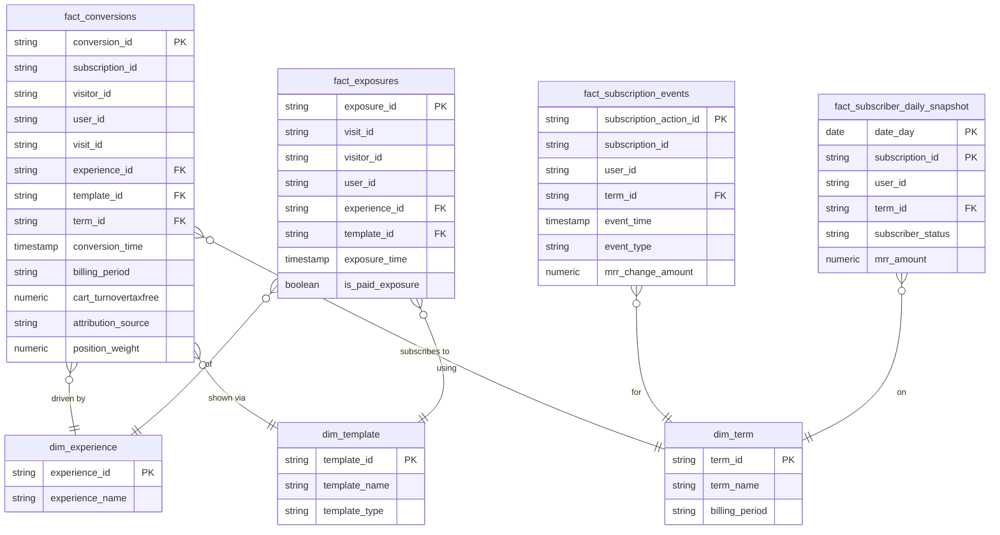

# DNS Transformations Project - Transformations

This repository contains the dbt project for transforming Piano analytics data into a structured dimensional model, ready for analysis. The primary goal is to model user behaviour, subscription events, and exposure to on-site experiences — as well as attribution of conversions to paid and organic traffic sources.

## The Data Model

This dbt project follows a layered data modelling approach to systematically progress data from its raw source format to clean, well-documented, and analysis-ready tables.

1. **Staging (`models/staging`)**: Light-touch cleaning of source data. Includes column renaming, type casting, device/OS standardisation, and basic filtering. Each staging model corresponds to one or two closely related source tables.

2. **Intermediate (`models/intermediate`)**: Complex transformations including multi-source joins, attribution logic, experience attribution, and incremental exposure deduplication. These produce reusable building blocks for the marts.

3. **Marts (`models/marts`)**: Final user-facing models structured as fact and dimension tables, designed for querying by analysts, data scientists, and BI tools.

---

## Data Sources

| Source | Schema | Description |
|--------|--------|-------------|
| `studios_piano_events` | `sdp_silver.studios_piano` | Piano events from the new BBC Studios organisation |
| `ps_piano_events` | `sdp_bronze.ps_piano` | Piano events from the legacy BBC organisation |
| `FACEBOOK_ADS.basic_ad` | `sdp_bronze` | Facebook Ads spend and impression data |
| `GOOGLE_ADS.STG_GOOGLE_ADS` | `sdp_project_sandbox` | Google Ads spend and impression data |

---

## Pipeline Overview



---

## Staging Models

| Model | Source | Description |
|-------|--------|-------------|
| `stg_piano__subs_events_web` | `studios_piano`, `ps_piano` | Web events from Piano. Standardises device/OS, extracts URL parameters (e.g. `at_bbc_team`), maps C1X fields. Filters to US geo and BBC subscription events since June 2025. |
| `stg_piano__subs_events_app` | `studios_piano`, `ps_piano` | Mobile app events from Piano. Classifies iOS/iPadOS/Android, labels as "Mobile App". Filters to US geo and mobile-app events since January 2026. |
| `stg_subscription_attribution` | `studios_piano`, `ps_piano`, Facebook Ads, Google Ads | Combines Piano events with ad platform data. Calculates per-visitor ad spend allocation and identifies paid traffic signals. |
| `stg_meta_google_spend_subs` | Facebook Ads, Google Ads | Joins ad platform spend, impressions, and clicks with Piano events for marketing spend analysis. |

---

## Intermediate Models

| Model | Materialisation | Description |
|-------|-----------------|-------------|
| `int_piano__conversion_attribution_web` | View | Attributes web conversions to the Piano experience that drove them. Looks back 1 day before conversion; prioritises paywall interactions over ribbon actions; defaults to landing page experience. |
| `int_piano__conversion_attribution_app` | View | Attributes mobile app conversions to experiences. Consolidates offsite (App Store/Play Store) and onsite conversions; fills forward experience/template IDs across the journey. |
| `int_piano__app_conversion_event_consolidation` | View | Merges offsite and onsite app conversion events within a 1-hour window. Estimates net revenue after app store fees (iOS 30%, Android 15%). |
| `int_piano__exposures_web` | Incremental (merge) | Deduplicates web exposure events by surrogate key. Fills forward experience names and flags paid traffic (`src='paid'` or `bbc_team IN ('8MS','DBS')`). |
| `int_piano__exposures_app` | Incremental (merge) | Mobile app exposure events. Joins with `app_experiences` and `app_templates` seed data; fills unknown experiences with default values. |
| `int_subscription_attribution` | View | Multi-touch attribution model. Identifies valid signups, paid touchpoints, and promo codes. Applies position-based weighting: 40/40/20 (first/last/middle) for organic, 30/30/30/10 (first/last/paid/middle) when a paid touchpoint exists, and a separate split when a promo code is in the path. |
| `int_subscription_attribution_src_corrected` | Table | Redistributes NULL attribution sources proportionally using deterministic hash-based random assignment. Breaks down generic "Search engines" into specific engines. |
| `int_subscriber_survival` | Table | Builds subscriber birth/death records for survival analysis. Records first subscription date, churn date, duration in days, and a binary churn event flag. |

---

## Marts

### Subscriptions (`marts/subscriptions/`)

#### Fact Tables

**`fact_conversions`** — One row per subscription conversion touchpoint.

| Column | Type | Description |
|--------|------|-------------|
| `conversion_id` | STRING | Piano unique conversion event ID |
| `subscription_id` | STRING | Related subscription ID |
| `visitor_id` | STRING | Piano unique visitor ID |
| `user_id` | STRING | Piano registered user ID |
| `visit_id` | STRING | Piano visit/session ID |
| `visit_time` | TIMESTAMP | Time of the visit |
| `conversion_time` | TIMESTAMP | Time of the conversion event |
| `term_id` | STRING | Subscription term ID |
| `term_name` | STRING | e.g. "Monthly", "Annual" |
| `term_offer_id` | STRING | Offer ID associated with the term |
| `term_offer_name` | STRING | Offer name |
| `billing_period` | STRING | e.g. "1 month", "1 year" |
| `vx_promo_code` | STRING | Promo code used at conversion (if any) |
| `subscription_period_number` | INT | Always 1 for new subscriptions |
| `cart_turnovertaxfree` | NUMERIC | Revenue excluding tax |
| `experience_id` | STRING | Piano Composer experience ID that drove the conversion |
| `experience_name` | STRING | Experience name |
| `card_id` | STRING | Piano card ID |
| `card_name` | STRING | Piano card name |
| `template_id` | STRING | Piano template ID |
| `template_name` | STRING | Template name |
| `ab_test_variant_name` | STRING | A/B test variant the user was in |
| `attribution_source` | STRING | "Paid" or "Organic" |
| `attribution_source_detail` | STRING | Detailed source (e.g. specific search engine, paid channel) |
| `position_weight` | NUMERIC | Multi-touch attribution weight (0.0–1.0) |
| `src` | STRING | Traffic source |
| `src_detail` | STRING | Detailed traffic source |
| `geo_id` | STRING | Surrogate key for geography |
| `geo_country` | STRING | Country |
| `geo_region` | STRING | Region/state |
| `geo_city` | STRING | City |
| `device_type` | STRING | Mobile / Desktop / Tablet |
| `app_type` | STRING | Web / Mobile App |
| `os_group` | STRING | iOS / Android / Windows / etc. |
| `c1x_lts` | STRING | C1X lifetime value score bucket |
| `c1x_content_likely_to_convert` | STRING | C1X propensity score |
| `c1x_likelihood_to_register` | STRING | C1X propensity score |
| `c1x_likelihood_to_return` | STRING | C1X propensity score |
| `c1x_revenue_auto_optimization` | STRING | C1X revenue optimisation signal |

---

**`fact_exposures`** — One row per exposure event (a visitor seeing a Piano Composer experience).

| Column | Type | Description |
|--------|------|-------------|
| `exposure_id` | STRING | Surrogate key (unique per exposure) |
| `visit_id` | STRING | Piano visit/session ID |
| `visitor_id` | STRING | Piano unique visitor ID |
| `user_id` | STRING | Registered user ID (null for unregistered visitors) |
| `visit_time` | TIMESTAMP | Time of the visit |
| `exposure_time` | TIMESTAMP | Time of the exposure event |
| `experience_id` | STRING | Piano experience ID |
| `experience_name` | STRING | Experience name |
| `card_id` | STRING | Piano card ID |
| `card_name` | STRING | Piano card name |
| `card_action` | STRING | "showOffer" or "showTemplate" |
| `template_id` | STRING | Piano template ID |
| `template_name` | STRING | Template name |
| `ab_test_variant_name` | STRING | A/B test variant |
| `device_type` | STRING | Mobile / Desktop / Tablet |
| `app_type` | STRING | Web / Mobile App |
| `os_group` | STRING | Operating system group |
| `bbc_team` | STRING | Team identifier for paid campaigns |
| `is_paid_exposure` | BOOLEAN | True if the exposure was driven by paid advertising |

---

**`fact_subscription_events`** — One row per subscription lifecycle event.

| Column | Type | Description |
|--------|------|-------------|
| `subscription_action_id` | STRING | Surrogate key |
| `subscription_id` | STRING | Piano subscription ID |
| `user_id` | STRING | Piano user ID |
| `event_time` | TIMESTAMP | Time of the event |
| `event_type` | STRING | "New Subscription", "Renewed", "Canceled", "Expired", "Renewal failed, will not retry" |
| `term_id` | STRING | Subscription term ID |
| `term_name` | STRING | Term name |
| `billing_period` | STRING | Billing period |
| `subscription_period_number` | INT | Renewal cycle number |
| `transaction_value` | NUMERIC | Revenue for this event |
| `previous_mrr` | NUMERIC | MRR before this event |
| `mrr_amount` | NUMERIC | MRR after this event |
| `mrr_change_amount` | NUMERIC | Change in MRR from this event |
| `cohort_month` | STRING | YYYY-MM of the subscriber's first conversion |
| `conversion_device_type` | STRING | Device at time of original conversion |
| `conversion_app_type` | STRING | App type at time of original conversion |
| `conversion_os_group` | STRING | OS at time of original conversion |
| `geo_id` | STRING | Geography surrogate key |
| `geo_country` | STRING | Country |
| `geo_region` | STRING | Region/state |
| `geo_city` | STRING | City |

---

**`fact_subscriber_daily_snapshot`** — One row per subscriber per day. Tracks daily subscription state.

| Column | Type | Description |
|--------|------|-------------|
| `date_day` | DATE | Snapshot date (PK with subscription_id) |
| `subscription_id` | STRING | Piano subscription ID (PK with date_day) |
| `user_id` | STRING | Piano user ID |
| `subscriber_status` | STRING | "Active", "Churned", or "Not Subscribed" |
| `last_subscription_action` | STRING | Most recent event type |
| `days_since_churned` | INT | 0 if currently active |
| `term_id` | STRING | Current term ID |
| `term_name` | STRING | Current term name |
| `billing_period` | STRING | Current billing period |
| `subscription_period_number` | INT | Current renewal cycle |
| `mrr_amount` | NUMERIC | Current MRR |
| `conversion_date` | DATE | Date of first "New Subscription" event |
| `days_since_conversion` | INT | Days since initial conversion |
| `months_since_conversion` | INT | Months since initial conversion (handles month-end edge cases) |
| `geo_id` | STRING | Geography surrogate key |
| `geo_country` | STRING | Country |
| `geo_region` | STRING | Region/state |
| `geo_city` | STRING | City |

---

**`fact_cohort_retention`** — One row per cohort × months since conversion. Used for cohort retention analysis.

| Column | Type | Description |
|--------|------|-------------|
| `cohort_month` | STRING | YYYY-MM of subscribers' first conversion |
| `cohort_size` | INT | Number of subscribers in the cohort |
| `months_since_conversion` | INT | Months elapsed since conversion |
| `active_subscribers` | INT | Subscribers still active at this period |

---

#### Dimension Tables

**`dim_experience`**

| Column | Type | Description |
|--------|------|-------------|
| `experience_id` | STRING (PK) | Piano Composer experience ID |
| `experience_name` | STRING | Experience name |

**`dim_template`**

| Column | Type | Description |
|--------|------|-------------|
| `template_id` | STRING (PK) | Piano template ID |
| `template_name` | STRING | Template name |
| `template_type` | STRING | "Paywall", "Ribbon", "Subscription Landing Page", or "Other" |

**`dim_term`**

| Column | Type | Description |
|--------|------|-------------|
| `term_id` | STRING (PK) | Piano subscription term ID |
| `term_name` | STRING | Term name |
| `billing_period` | STRING | Billing period |
| `term_offer_id` | STRING | Offer ID |
| `term_offer_name` | STRING | Offer name |

---

### Attribution (`marts/SubscriptionAttribution/`)

| Model | Description |
|-------|-------------|
| `subscription_attribution_model` | Attribution-weighted conversions with annualised revenue estimates. Joins renewal data and applies lifetime-weighted revenue calculations. |
| `marketing_spend_subs` | Pass-through of aggregated marketing spend data for reporting. |
| `facebook_ads__url_report` | Breakdown of Facebook Ads performance by URL parameters. |

### Audience (`marts/audience/`)

| Model | Description |
|-------|-------------|
| `fact_visitors_daily` | Daily visitor counts broken down by device type, app type, and OS. |
| `dim_app_type` | Mobile / Web app type reference dimension. |
| `dim_device_type` | Device type reference dimension. |
| `dim_os_group` | Operating system group reference dimension. |

---

## Star Schema



---

## Attribution Model

The subscription attribution model (`int_subscription_attribution`) implements a position-based multi-touch attribution approach:

1. **Valid signups** are identified from new subscription conversion events.
2. **Paid touchpoints** are identified from staging data where ad spend can be attributed.
3. **First, last, and paid touchpoints** are extracted for each conversion.
4. **Promo code detection** flags conversions where a promo code appeared in the journey.
5. **Weights are assigned** based on the path type:
   - *Organic, no promo*: 40% first touch / 40% last touch / 20% distributed across middle touches
   - *Paid touchpoint present*: 30% first touch / 30% last touch / 30% paid touch / 10% distributed across remaining
   - *Promo code in path*: adjusted split to credit the promo touchpoint

NULL attribution sources are redistributed proportionally using deterministic hash-based random assignment in `int_subscription_attribution_src_corrected`.

---

## Seeds

| Seed | Description |
|------|-------------|
| `app_experiences` | Lookup of known mobile app experience IDs and names |
| `app_templates` | Lookup of known mobile app template IDs and names |
| `geo_mapping` | Geography reference data |
| `piano_retention_curves` | Expected retention curves for survival analysis benchmarking |

---

## Analyses

The `analyses/` directory contains exploratory queries that build on the mart tables:

- `survival_data.sql`: Uses `fact_subscription_events` to prepare data for subscriber survival analysis, calculating tenure duration and churn status per subscription.

---

## Development

Ensure you have a `profiles.yml` configured for your Snowflake connection. See the [dbt documentation](https://docs.getdbt.com/docs/core/connect-data-platform/connection-profiles) for setup instructions.

Key commands:

```bash
dbt run          # Execute all models
dbt test         # Run all data and schema tests
dbt build        # Run models and tests together
dbt run -s staging.*          # Run only staging models
dbt run -s marts.subscriptions.*  # Run only subscription marts
```
