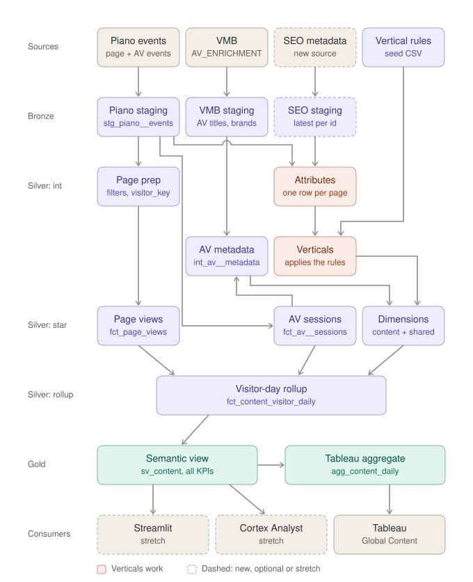

# Data flow: Piano events to the Global Content dashboard

_Last updated 22 Oct 2026._

Piano events become two silver facts, page views and AV sessions, which are summed into one visitor-day rollup. Every KPI is then defined once, in `sv_content`. Content attributes, verticals and AV metadata are built on the side and joined to the facts on their keys. Each section below follows one stage of that flow, in build order. The last section lists what reviewers need to confirm.

## At a glance



Arrows point from a model to the models that read it. Only one runs upward, from AV sessions to AV metadata, because the metadata picks each video's properties from its sessions.

| Model | Layer | One row per | Status |
| --- | --- | --- | --- |
| `stg_piano__events` | Bronze | Piano event | Existing |
| `stg_vmb__av_enrichment` | Bronze | AV item | Existing |
| `int_article__metadata` | Silver, intermediate | Page | New |
| `int_content__verticals` | Silver, intermediate | Page | New |
| `int_av__metadata` | Silver, intermediate | AV item | New |
| `fct_page_views` | Silver, fact | Page view | Existing |
| `fct_av__sessions` | Silver, fact | AV session | New |
| `dim_content` | Silver, dimension | Content ID | Planned |
| `fct_content_visitor_daily` | Silver, rollup | Date × visitor × content × AV item × country × device × app | New |
| `sv_content` | Gold | (semantic view) | Planned |
| `agg_content_daily` | Gold | Content × date × platform | Planned |

## Sources and bronze

Only bronze calls `source()`. Staging renames, casts and dedupes, and adds no business logic. Everything downstream reads `ref()`.

| Source | Staging model | What staging does |
| --- | --- | --- |
| Piano events, `SDP_SILVER.STUDIOS_PIANO.STUDIOS_PIANO_EVENTS` | `stg_piano__events` | One row per event, deduplicated. |
| VMB enrichment, `SDP_SILVER.VMB.AV_ENRICHMENT` | `stg_vmb__av_enrichment` | Titles, show, episode, brands and genre names. One row per `av_content_id`. |
| SEO metadata, `SDP_BRONZE.CONTENT_METADATA_SEO.BBC_CONTENT_METADATA` | SEO staging (new) | The latest row per ID. |
| Country-to-region table, `SDP_GOLD.LOOKUPS.BBCS_REGION_COUNTRY_LOOKUPS` | `stg_reference__country_regions` | One row per country and region. The source of truth for region-to-country mapping. |
| Seeds in the repo | `vertical_rules` | One row per rule condition. Edited in the CSV, never in SQL. |

Piano data arrives Day-1, and Piano reprocesses recent days. That's why every incremental model downstream rebuilds a few days back, not just yesterday.

## Shared rules

Each rule lives in one macro or seed, so no model can drift from another. **UK traffic is a flag, not a filter.** Facts keep UK rows. Only the parity queries, and the two models that pick metadata (attributes and AV metadata), drop UK traffic, so their picks match the old SQL.

| Rule | Macro or seed | What it does | Used by |
| --- | --- | --- | --- |
| In-scope sites | `filter_piano_site_ids()` (`site_id_mapping.csv`) | Keeps Global Content sites. | Attributes, AV sessions, page views |
| Non-content pages | `filter_page_exclusions()` (`page_exclusions.csv`) | Filter non-content pages (for example `keepalive`, `error.page`), missing page. | Every model that reads events |
| UK apps | `filter_exclude_uk_app_name()` | `ilike '%uk%'` or `'%chrysalis%'`. Filters out UK app. | page_views, av_ sessions |
| Embedded or missing URL | `filter_exclude_url()` | True when the URL contains `embed`, or is missing. | Report queries only (`filter_exclusions(check_url=true)`) |
| Visitor key | `visitor_key()` (`visitor_key.sql`) | `visitor_id` before 7 Apr 2026, then `ckns_echo_device_id`. No fallback between them. | AV sessions; page views should use it too |
| Content type | `content_type_group()`, `content_type_detail()` | Maps the raw content type to a group and a detail. Vertical video is checked first (`av_content_duration_range = 'sfv-vertical'`). | `dim_content` |
| Vertical rules | `vertical_rules` seed | One row per condition: same `condition_group` = OR, different groups = AND, lowest `priority` wins. | Verticals |

## Content attributes and verticals

Piano sends section, topic, pillar and URL on every event, and they don't always agree for the same page. `int_article__metadata` picks one set per page, then `int_content__verticals` turns that set into a vertical. Both are tables, and both are translations of the Global Content Dashboard SQL, so their picks match the old dashboard.

**`int_article__metadata`**: one row per page (`content_nk` = `page`).

1. Read `page.display` events from 1 Sept 2025 (the `content_attributes_start` var) on in-scope sites. Drop junk pages and UK apps, and, to copy the old SQL, UK traffic and rows with no country.
2. Blank section, topic and pillar on `home.page`, `news.page` and `sport.page`. Front pages carry whatever story is promoted on them.
3. Pick section, topic, pillar and URL **together**, as one combination:
   - a combination with a section beats any without one, then the same for topic, pillar and URL
   - page views only break ties, then the latest event, then the values
   - complete beats popular, as in the old query
   - the weather, storyworks and news-languages sites don't count towards this pick
4. Pick content ID and content type separately: the most frequent non-null value.
5. Pick title and publish date as a pair: the most frequent one.
6. Add page views in the window. These are used only to choose one page per `content_id` for `dim_content`, never for reporting.

**`int_content__verticals`**: one row per page, with `vertical`, `vertical_rule_id`, `matched_verticals` and `is_business`.

1. Replace `$` with `&` in section, topic and pillar, so the seed lists each name once.
2. Cross-join each page with the active rule conditions, and test each one (`equals`, `like`, `ilike`, `startswith`).
3. A rule matches when every one of its condition groups has a hit.
4. The lowest `priority` wins, like the first `WHEN` of a `CASE`. Pages that match no rule get `Unclassified`.
5. `matched_verticals` lists every vertical that matched, ignoring priority. `is_business` reads it, so a Travel article with a Business pillar still counts as Business.

The 13 rules run in the same order as the final `CASE`: Home page, News front, Sport, Audio, Docs, Travel, Business, Health, Culture, Earth & Science, Tech, US & Canada News, World News.

**`dim_content`** (planned) is keyed on `content_id`. It takes each content ID's most-viewed page, joins that page's attributes and vertical, and adds the content type from the macros.

## Facts: page views and AV sessions

The two facts record different business events, at different grains, so they stay separate tables. Both keep UK traffic, and both have enforced contracts: a renamed or retyped column fails the build instead of breaking a report.

| | `fct_page_views` | `fct_av__sessions` |
| --- | --- | --- |
| One row per | Page view (`page.display` event) | AV session (`av_session_id`) |
| Status | Existing; needs `page`, `url`, `src`, `src_detail`, `src_url` added | New |
| Main measure | `page_display_event_count` (summed for parity) | `is_playback`: content consumed > 0 |
| Build | Incremental | Incremental merge on `av_session_id`, clustered by `session_start_date` |
| Joins on | `content_id`, date, visitor, country, platform | `content_id`, `av_content_id` (the video), date, visitor, country, platform |

**How `fct_av__sessions` is built:**

1. Read AV events (`av_session_id` not null) on in-scope sites, without junk pages.
2. Group each session's events into one row. The old query grouped by every column, so a session whose values changed between events became several rows.
   - Text columns (page, content IDs, visitor IDs, country, app, device, AV properties) take the **first non-null value** in the session: `min_by(col, iff(col is not null, event_time, null))`.
   - The session totals (time consumed, playback duration, completion rate) take the **max**, the latest running total.
   - `av_plays` counts `av.play` and `rm.play` events.
3. Add `visitor_key` with the macro, and the two flags:
   - `is_playback`: content time consumed > 0
   - `is_complete_playback`: a playback with a completion rate of at least 0.95
4. Cast every column to its contract type.

Completion rate = `count_if(is_complete_playback) / count_if(is_playback)` at query time, which gives the same number.

The AV properties on this fact (duration, type, broadcasting type, genre, duration range) are **as reported on that session**. They exist so AV metadata can pick one value per video. Reports should use `int_av__metadata`.

## AV metadata

`int_av__metadata` gives each video or audio item one set of properties, keyed on `av_content_id`. It reads `fct_av__sessions`, not the raw events, for three reasons:

- **The old query worked the same way.** It ranked properties over its one-row-per-session step, and counted sessions.
- **It's cheaper.** The fact has one row per session, instead of every heartbeat event.
- **The metadata and the fact see the same sessions,** with the same sites, filters and first-non-null rule.

**How it's built:**

1. List every `av_content_id` in the fact, so an item seen only in UK traffic still gets a row and its VMB titles.
2. Choose the sessions that count towards the pick, copying the old SQL: no UK traffic, no UK apps, no missing country or app name, and not the weather, storyworks or news-languages sites. Vars control each of these.
3. Pick duration, content type, broadcasting type and genre **together**: complete beats popular, then the most sessions, then the latest session as a tie-break.
4. Pick the duration range on its own, the same way.
5. Join the VMB titles, show, episode, brands and genre names.
6. `av_sessions` records how many sessions counted. A value of 0 means the Piano properties are null.

**Layering rule:** this intermediate model reads from a fact, which is unusual but leaves no loop in the dependency graph. `fct_av__sessions` must never `ref` `int_av__metadata`, or dbt will report a cycle. Video type and titles are joined at query time, on `av_content_id`.

## Visitor-day rollup

`fct_content_visitor_daily` has one row per date × visitor × content item × AV item × country × device type × app. Unique visitors can't be added across days, so the table keeps `visitor_key` and lets the semantic view count it distinct for any period or cut. It is still far smaller than the raw events.

**How it's built:**

1. **Page-view rows** come from `fct_page_views`: `page_views` = `page_display_event_count`, and `av_content_id` is null. One CTE (`page_view_rows`) names all the page-view columns.
2. **AV rows** come from `fct_av__sessions`, dated by session start. Each carries both `content_id` (the page the player was on) and `av_content_id` (the video).
3. Union the two and group by the grain. Every measure is additive:
   - `page_views`, `av_sessions`, `av_playbacks`, `av_complete_playbacks`, `av_plays`
   - `av_playback_seconds`, `av_content_seconds_consumed`
   - `av_completion_rate_sum` and `av_completion_rate_sessions`, which give the old average completion rate when divided
4. Cast every column to its contract type.

Because content and AV items sit on the same rows, one table answers both "visitors to this article" and "views of this video". Video vs audio comes from `int_av__metadata` at query time. The plan also listed traffic source in the grain. It's left out, because AV sessions carry no `src`, so every AV row would show as unknown.

## Gold

`sv_content` (built with `dbt_semantic_view`) is the only place a KPI is defined. It reads the rollup and joins the dimensions. `agg_content_daily` is a table selected from it (content × date × platform) for Tableau. Gold is still to build. These are the definitions the rollup supports:

| Metric | Expression on the rollup | Note |
| --- | --- | --- |
| Page views | `sum(page_views)` | |
| Video views | `sum(av_playbacks)` where `av_content_type = 'Video'` | Type from `int_av__metadata` |
| Audio listens | `sum(av_playbacks)` where `av_content_type = 'Audio'` | Not podcast downloads |
| Unique visitors | `count(distinct visitor_key)` | Devices, not people |
| AV plays | `sum(av_plays)` | `av.play` and `rm.play` events |
| Play time (hours) | `sum(av_playback_seconds) / 3600` | |
| Full consumption rate | `sum(av_complete_playbacks) / nullif(sum(av_playbacks), 0)` | Old query: completion of at least 0.95 |
| Average completion rate | `least(1, sum(av_completion_rate_sum) / nullif(sum(av_completion_rate_sessions), 0))` | Old query: sessions with a rate above 0 |
| Views per visitor | Page views ÷ unique visitors | Derived |

## Builds

The incremental models rebuild **3 days** back on every run, because Piano reprocesses recent data. The rollup uses the same window as the AV fact, so every rebuilt session reaches it. dbt works out the run order from the `ref`s, so `dbt build` runs everything in order.

| Model | Materialisation | Each run rebuilds | Window vars (both dates inclusive) |
| --- | --- | --- | --- |
| `stg_piano__events` | Incremental merge | The last 3 days of events | |
| `int_article__metadata` | Table | Everything in the window | `content_attributes_start` (default 2025-09-01), `content_attributes_end` |
| `int_content__verticals` | Table | Everything | |
| `fct_av__sessions` | Incremental merge on `av_session_id` | Sessions that started in the last 3 days, reading 1 extra day of events | `av_sessions_start` (default 2025-09-01), `av_sessions_end`, `av_sessions_lookback_days` |
| `int_av__metadata` | Table | Everything | `av_metadata_start`, `av_metadata_end` |
| `fct_content_visitor_daily` | Incremental `delete+insert` on `date_key` | The last 3 dates | `rollup_lookback_days` |

The extra day of events stops a session that started just before the window from being rebuilt from only half its events. A session that lasts more than about a day, and started before the window, keeps its old row.

**Parity build** (September, into a dev schema). Name the models rather than using the `+` selector: a full refresh of staging would rebuild every event from scratch.

```bash
dbt build -s int_article__metadata int_content__verticals fct_av__sessions int_av__metadata --full-refresh --vars '{av_sessions_start: 2026-09-01, av_sessions_end: 2026-09-30, av_metadata_start: 2026-09-01, av_metadata_end: 2026-09-30, content_attributes_start: 2026-09-30, content_attributes_end: 2026-09-30}'
```

Everyone builds into their own dev schema with the project role. Tables created under another role can't be truncated by dbt, which is what broke the seeds on 22 Oct.

## Tests and parity checks

Every check below either fails the build or warns. Parity is judged against two baselines, Tableau and the Piano UI, so any gap can be traced to the old SQL or to the new pipeline.

| Check | Where | What fails it |
| --- | --- | --- |
| Grain | `unique` on `av_session_id`, `content_nk`, `av_content_id`; `unique_combination_of_columns` on the rollup grain | A join that duplicates rows |
| Contracts | `fct_av__sessions`, `fct_content_visitor_daily` | A renamed or retyped column |
| Unit test | `fct_av_sessions_one_row_per_session` | Several events not becoming one row; first non-null or max picked wrongly; junk or out-of-scope rows kept |
| Unit test | `int_content__verticals` | AND/OR or priority logic |
| Seed checks | `accepted_values` on `field` and `match_type`; `vertical_rules_consistent` | A rule ID with two priorities or verticals; a typo such as a trailing space in `ilike ` |
| Warnings | `vertical_rules_unused`; `vertical_unclassified_share` above 5% | A rule that never matches; too many pages unclassified |
| Reconciliation | `rollup_page_views_match_fact`, `rollup_av_matches_fact` | Any day where rollup totals differ from the facts |

## Open questions for reviewers

Each of these changes a number or a model, so settle them before parity sign-off.

**Data checks**

- [ ] **Missing app names.** The old AV query's `NOT (app_name like any (...))` drops rows with no app name. If web traffic has none, the old AV numbers left out all web video. The new facts keep these rows; only the metadata pick and the parity query copy the old behaviour.
- [ ] **Session totals.** Taking the max assumes Piano repeats a running total on every AV event. If the values are per-event amounts, they should be summed instead. The check query is in the AV models' notes.
- [ ] **Domain names.** The final `CASE` matches `bbc.com`, `bbc InDepth` and `bbc Verify`, and the seed matches `bbc`. They must agree with the real data, or 12 rules never match.
- [ ] **Culture shadows other verticals.** `%Art%` matches inside "Earth", "Artificial intelligence", "Heart" and "Smart", and Culture runs before Earth & Science and Tech. The old `CASE` does the same, so parity holds, but it's probably unintended.
- [ ] **One country, two regions.** "France Overseas Territories" is listed under two regions in the country-to-region table. Should be assigned to Africa.