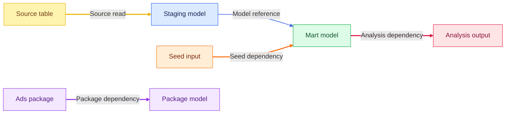
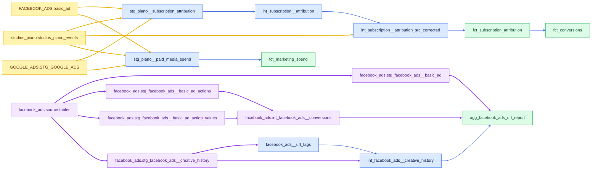
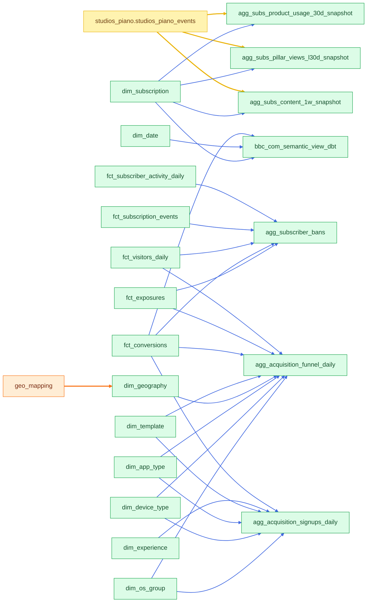
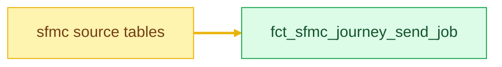

# DNS Transformations Lineage

This is the dependency reference for the `dns_transformations` dbt project. Arrows point from upstream to downstream, left to right. Names in the diagrams are the dbt model or source table names as they exist in the project. For what each model means, see the [Models](https://bbcworldwide.atlassian.net/wiki/spaces/CG/folder/7672725513) pages in Confluence; the [README](../README.md) links to the rest of the documentation.

### Color legend

| Diagram element | Color | Definition |
| --- | --- | --- |
| Source node | Yellow | Declared external source table read with dbt `source()` |
| Seed node | Orange | dbt seed input |
| Model node | Blue | Project-owned staging or intermediate model |
| Mart node | Green | Project-owned user-facing mart, fact, dimension, or aggregate |
| Package node | Purple | Model or source belonging to the installed `facebook_ads` package |
| Analysis node | Red | SQL analysis output under `analyses/` |
| `ref()` connection | Blue | Dependency between dbt models |
| Direct source connection | Yellow | Dependency from a declared external source table |
| Seed connection | Orange | Dependency from a dbt seed |
| Package connection | Purple | Dependency within the `facebook_ads` package DAG |
| Analysis connection | Red | Dependency leading to an analysis output |

### How to read the diagrams

The following example below uses the same node (rectangle) and connection (arrow) styles as the lineage charts. The rectangle's color tells you what the item is; arrow's color tells you what kind of dependency the arrow represents.

### Core event and subscription flow

```mermaid
graph LR
    classDef source fill:#fff3b0,stroke:#eab308,color:#713f12
    classDef seed fill:#ffedd5,stroke:#f97316,color:#7c2d12
    classDef model fill:#dbeafe,stroke:#2563eb,color:#172554
    classDef mart fill:#dcfce7,stroke:#16a34a,color:#14532d
    classDef analysis fill:#ffe4e6,stroke:#e11d48,color:#881337
    piano["studios_piano.studios_piano_events"]:::source --> composer["stg_piano__composer_events"]:::model
    composer --> web["int_piano__conversion_attribution_web"]:::model
    composer --> offsite_con["int_piano__offsite_conversion_event_consolidation"]:::model
    offsite["stg_piano__offsite_events"]:::model --> offsite_con
    offsite_con --> app["int_piano__conversion_attribution_app"]:::model
    composer --> web_exp["int_piano__exposures_web"]:::model
    composer --> app_exp["int_piano__exposures_app"]:::model
    experience["dim_experience"]:::mart --> web_exp
    experience --> app_exp
    web --> conversions["fct_conversions"]:::mart
    app --> conversions
    web_exp --> exposures["fct_exposures"]:::mart
    app_exp --> exposures
    conversions --> events["fct_subscription_events"]:::mart
    composer --> events
    offsite --> events
    events --> snapshot["fct_subscriber_daily_snapshot"]:::mart
    subscription["dim_subscription"]:::mart --> snapshot
    date["dim_date"]:::mart --> snapshot
    snapshot --> activity["fct_subscriber_activity_daily"]:::mart
    analytics["stg_piano__analytics_events"]:::model --> activity
    snapshot --> retention["fct_cohort_retention"]:::mart
    analytics --> visitors["fct_visitors_daily"]:::mart
    events --> subscription
    current["int_piano__subscription_current"]:::model --> subscription
    snapshots["dns_transformations.piano_subscription_snapshots"]:::source --> staged["stg_piano__subscription_snapshots"]:::model --> current
    composer --> experience
    composer --> template["dim_template"]:::mart
    conversions --> term["dim_term"]:::mart
    date --> engaged_month["agg_engaged_subscribers_monthly"]:::mart
    activity --> engaged_month
    date --> engaged_week["agg_engaged_subscribers_weekly"]:::mart
    activity --> engaged_week
    events --> survival["int_subscription__survival"]:::model
    conversions --> survival
    experience --> survival
    survival --> analysis["analyses/survival_data.sql"]:::analysis
    linkStyle 0,25 stroke:#eab308,stroke-width:2.5px
    linkStyle 37 stroke:#e11d48,stroke-width:2.5px
```

### Attribution and Facebook package flow

### Dimensions, reporting, and semantic outputs

### Salesforce output

## Complete model dependency inventory

The following inventory records every project-owned model in the dbt manifest and its direct upstream dependencies. `source:` identifies a declared source table and `seed:` identifies a dbt seed. Models from the installed `facebook_ads` package are shown separately under [Cross-DAG and cross-project references](#cross-dag-and-cross-project-references).

### Staging

| Model | Direct upstream dependencies |
| --- | --- |
| `stg_piano__paid_media_spend` | `source:studios_piano.studios_piano_events`, `source:FACEBOOK_ADS.basic_ad`, `source:GOOGLE_ADS.STG_GOOGLE_ADS` |
| `stg_piano__analytics_events` | `source:studios_piano.studios_piano_events` |
| `stg_piano__composer_events` | `source:studios_piano.studios_piano_events` |
| `stg_piano__offsite_events` | `source:studios_piano.studios_piano_events` |
| `stg_piano__subscription_snapshots` | `source:dns_transformations.piano_subscription_snapshots` |
| `stg_piano__subscription_attribution` | `source:studios_piano.studios_piano_events` |

### Intermediate

| Model | Direct upstream dependencies |
| --- | --- |
| `int_facebook_ads__creative_history` | `facebook_ads__url_tags`, `facebook_ads.stg_facebook_ads__creative_history` |
| `int_piano__conversion_attribution_app` | `int_piano__offsite_conversion_event_consolidation`, `dim_experience`, `stg_piano__composer_events` |
| `int_piano__conversion_attribution_web` | `stg_piano__composer_events` |
| `int_piano__exposures_app` | `stg_piano__composer_events`, `dim_experience` |
| `int_piano__exposures_web` | `stg_piano__composer_events`, `dim_experience` |
| `int_piano__offsite_conversion_event_consolidation` | `stg_piano__offsite_events`, `stg_piano__composer_events` |
| `int_piano__subscription_current` | `stg_piano__subscription_snapshots` |
| `int_subscription__survival` | `fct_subscription_events`, `fct_conversions`, `dim_experience` |
| `int_subscription__attribution` | `stg_piano__subscription_attribution` |
| `int_subscription__attribution_src_corrected` | `source:studios_piano.studios_piano_events`, `int_subscription__attribution` |

### Core and subscription facts and dimensions

| Model | Direct upstream dependencies |
| --- | --- |
| `dim_app_type` | None; static reference model |
| `dim_date` | None; static date spine model |
| `dim_device_type` | None; static reference model |
| `dim_experience` | `stg_piano__composer_events`, `seed:experience_app_type` |
| `dim_geography` | `seed:geo_mapping` |
| `dim_os_group` | None; static reference model |
| `dim_subscription` | `int_piano__subscription_current`, `fct_subscription_events` |
| `dim_template` | `stg_piano__composer_events` |
| `dim_term` | `fct_conversions` |
| `fct_conversions` | `int_piano__conversion_attribution_web`, `int_piano__conversion_attribution_app`, `fct_subscription_attribution` |
| `fct_exposures` | `int_piano__exposures_web`, `int_piano__exposures_app` |
| `fct_subscription_events` | `fct_conversions`, `stg_piano__composer_events`, `stg_piano__offsite_events` |
| `fct_subscriber_daily_snapshot` | `fct_subscription_events`, `dim_subscription`, `dim_date` |
| `fct_subscriber_activity_daily` | `fct_subscriber_daily_snapshot`, `stg_piano__analytics_events` |
| `fct_cohort_retention` | `fct_subscriber_daily_snapshot` |
| `fct_visitors_daily` | `stg_piano__analytics_events` |
| `fct_marketing_spend` | `stg_piano__paid_media_spend` |
| `fct_subscription_attribution` | `source:studios_piano.studios_piano_events`, `int_subscription__attribution_src_corrected` |
| `agg_facebook_ads_url_report` | `facebook_ads.stg_facebook_ads__basic_ad`, `facebook_ads.int_facebook_ads__conversions`, `int_facebook_ads__creative_history`, `facebook_ads.stg_facebook_ads__account_history`, `facebook_ads.stg_facebook_ads__ad_history`, `facebook_ads.stg_facebook_ads__ad_set_history`, `facebook_ads.stg_facebook_ads__campaign_history` |

### Reporting and semantic outputs

| Model | Direct upstream dependencies |
| --- | --- |
| `agg_acquisition_funnel_daily` | `dim_template`, `fct_exposures`, `fct_conversions`, `fct_visitors_daily`, `dim_geography`, `dim_app_type`, `dim_device_type`, `dim_os_group` |
| `agg_acquisition_signups_daily` | `fct_conversions`, `dim_experience`, `dim_template`, `dim_app_type`, `dim_device_type`, `dim_os_group` |
| `agg_engaged_subscribers_monthly` | `fct_subscriber_activity_daily`, `dim_date` |
| `agg_engaged_subscribers_weekly` | `fct_subscriber_activity_daily`, `dim_date` |
| `agg_subs_content_1w_snapshot` | `source:studios_piano.studios_piano_events`, `dim_subscription` |
| `agg_subs_pillar_views_l30d_snapshot` | `source:studios_piano.studios_piano_events`, `dim_subscription` |
| `agg_subs_product_usage_30d_snapshot` | `source:studios_piano.studios_piano_events`, `dim_subscription` |
| `agg_subscriber_bans` | `fct_subscriber_activity_daily`, `fct_subscription_events`, `fct_visitors_daily`, `fct_conversions`, `fct_exposures` |
| `bbc_com_semantic_view_dbt` | `fct_conversions`, `dim_date`, `dim_subscription` |
| `fct_sfmc_journey_send_job` | `source:sfmc.sent`, `source:sfmc.opens`, `source:sfmc.clicks`, `source:sfmc.bounces`, `source:sfmc.unsubs`, `source:sfmc.send_jobs`, `source:sfmc.journey`, `source:sfmc.journey_activity`, `source:sfmc.list_subscribers` |

### Declared sources without a current downstream model

These sources are configured in `models/bronze/<source>/_<source>__sources.yml` but do not appear in a current model `source()` call: `source:ps_piano.ps_piano_events` and `source:sfmc.not_sent`. They are retained as declared inputs for future use, but are not part of the active source-to-mart flow.

## Cross-DAG and cross-project references

- `agg_facebook_ads_url_report` and `int_facebook_ads__creative_history` are project-owned models that depend on models from the installed `facebook_ads` dbt package. That package DAG must be available before these local outputs are built.
- `fct_conversions` depends on `fct_subscription_attribution`, so the attribution mart is upstream of the canonical conversion fact.
- `fct_subscription_attribution` and the `agg_subs_*` content and pillar models read `studios_piano.studios_piano_events` directly in addition to local models.
- `stg_piano__subscription_snapshots` depends on the daily external Piano API upload to `piano_subscription_snapshots`.
- No direct `ref()` to a mart in a sibling repository is present in this project's model SQL. The explicit dbt project boundary is the installed `facebook_ads` package.

## Scheduling order

1. Load the declared source tables and the daily `piano_subscription_snapshots` upload.
2. Build bronze staging models.
3. Build silver intermediate models and the `facebook_ads` package models.
4. Build silver facts and dimensions (subscription, attribution, engagement, and core).
5. Build gold reporting aggregates after their fact and dimension inputs.