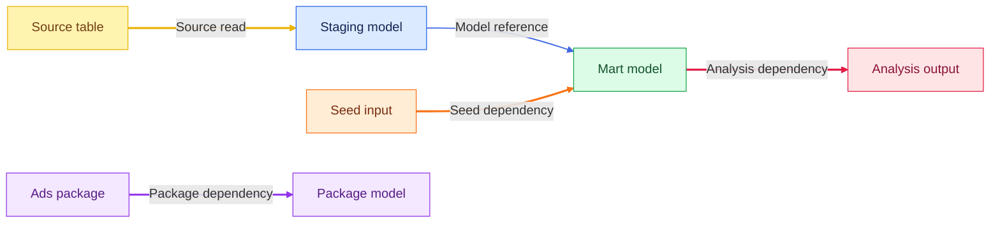
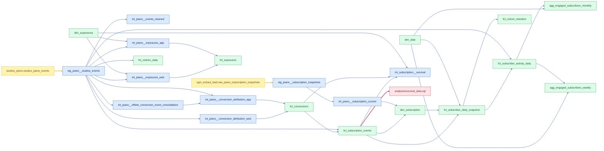
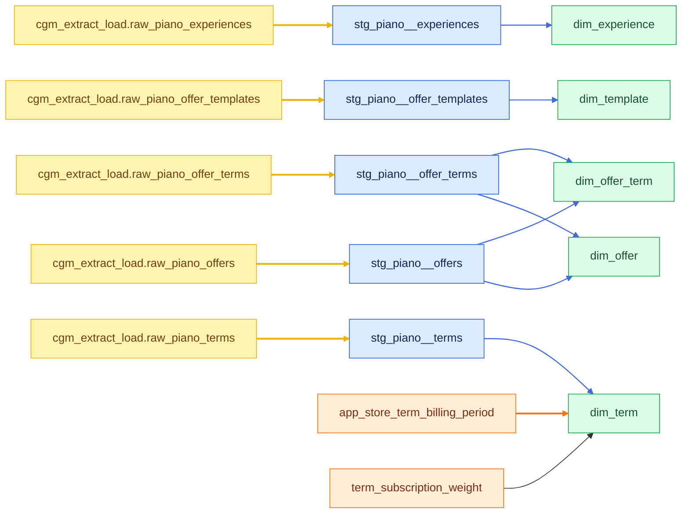
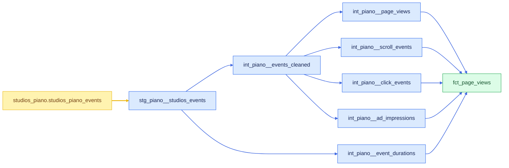
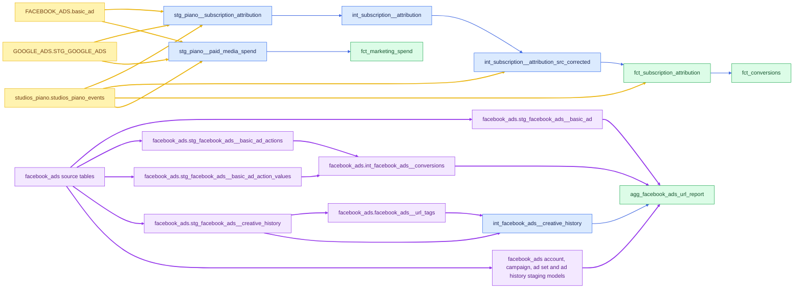
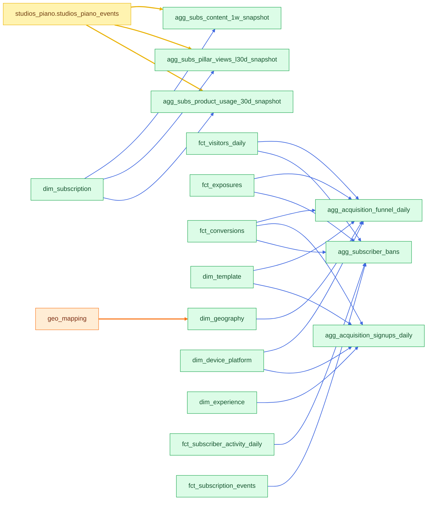
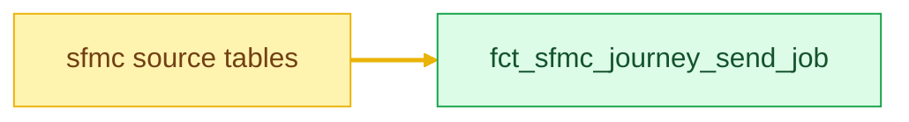

# DNS Transformations Lineage

This is the dependency reference for the `dns_transformations` dbt project. Arrows point from upstream to downstream, left to right. Names in the diagrams are the dbt model or source table names as they exist in the project. For what each model means, see the [Models](https://bbcworldwide.atlassian.net/wiki/spaces/CG/folder/7672725513) pages in Confluence; the [README](../README.md) links to the rest of the documentation.

### Color legend

| Diagram element | Color | Definition |
| --- | --- | --- |
| Source node | Yellow | Declared external source table read with dbt `source()` |
| Seed node | Orange | dbt seed input |
| Model node | Blue | Project-owned staging or intermediate model |
| Mart node | Green | Project-owned user-facing mart, fact, dimension, or aggregate |
| Package node | Purple | Model or source belonging to the installed `facebook_ads` package |
| Analysis node | Red | SQL analysis output under `analyses/` |
| `ref()` connection | Blue | Dependency between dbt models |
| Direct source connection | Yellow | Dependency from a declared external source table |
| Seed connection | Orange | Dependency from a dbt seed |
| Package connection | Purple | Dependency within the `facebook_ads` package DAG |
| Analysis connection | Red | Dependency leading to an analysis output |

### How to read the diagrams

The following example below uses the same node (rectangle) and connection (arrow) styles as the lineage charts. The rectangle's color tells you what the item is; arrow's color tells you what kind of dependency the arrow represents.

### Core event and subscription flow

### Piano catalogue dimensions

`dim_experience`, `dim_template`, `dim_term`, `dim_offer` and `dim_offer_term` are built only from daily snapshots of the Piano API, loaded by the `piano_catalog` job in [cgm-extract-load](https://github.com/bbc/cgm-extract-load), and the `app_store_term_billing_period` and `term_subscription_weight` seeds. Records the Piano list endpoints leave out (archived experiences, system templates) are backfilled by id into the same raw tables with `cgm-extract-load backfill-piano-catalog`.

### Page view flow

Only events with a `pageview_id` reach these models, which in practice means web (js) traffic. Each intermediate aggregates to one row per `pageview_id`.

`int_piano__events_cleaned` and `stg_piano__studios_events` are views, so each intermediate reads the Piano source directly with its own event-time window. The scheduled run only processes recent days. The history of `int_piano__page_views` and `fct_page_views` is built outside the scheduled run, in date chunks, with the `piano_backfill_start` and `piano_backfill_end` vars (see "Backfilling the Piano page view models" in the DNS Transformations Runbook).

### Attribution and Facebook package flow

### Dimensions and reporting outputs

### Salesforce output

## Complete model dependency inventory

The following inventory records every project-owned model in the dbt manifest and its direct upstream dependencies. `source:` identifies a declared source table and `seed:` identifies a dbt seed. Models from the installed `facebook_ads` package are shown separately under [Cross-DAG and cross-project references](#cross-dag-and-cross-project-references).

### Staging

| Model | Direct upstream dependencies |
| --- | --- |
| `stg_piano__paid_media_spend` | `source:studios_piano.studios_piano_events`, `source:FACEBOOK_ADS.basic_ad`, `source:GOOGLE_ADS.STG_GOOGLE_ADS` |
| `stg_piano__studios_events` | `source:studios_piano.studios_piano_events` |
| `stg_piano__subscription_snapshots` | `source:cgm_extract_load.raw_piano_subscription_snapshots` |
| `stg_piano__experiences` | `source:cgm_extract_load.raw_piano_experiences` |
| `stg_piano__offers` | `source:cgm_extract_load.raw_piano_offers` |
| `stg_piano__offer_terms` | `source:cgm_extract_load.raw_piano_offer_terms` |
| `stg_piano__offer_templates` | `source:cgm_extract_load.raw_piano_offer_templates` |
| `stg_piano__terms` | `source:cgm_extract_load.raw_piano_terms` |
| `stg_piano__subscription_attribution` | `source:studios_piano.studios_piano_events` |
| `stg_piano__studios_events` | `source:studios_piano.studios_piano_events` |

### Intermediate

| Model | Direct upstream dependencies |
| --- | --- |
| `int_facebook_ads__creative_history` | `facebook_ads.facebook_ads__url_tags`, `facebook_ads.stg_facebook_ads__creative_history` |
| `int_piano__conversion_attribution_app` | `int_piano__offsite_conversion_event_consolidation`, `stg_piano__studios_events` |
| `int_piano__conversion_attribution_web` | `stg_piano__studios_events` |
| `int_piano__events_cleaned` | `stg_piano__studios_events` |
| `int_piano__exposures_app` | `stg_piano__studios_events`, `dim_experience` |
| `int_piano__exposures_web` | `stg_piano__studios_events`, `dim_experience` |
| `int_piano__offsite_conversion_event_consolidation` | `stg_piano__studios_events` |
| `int_piano__subscription_current` | `stg_piano__subscription_snapshots` |
| `int_piano__events_cleaned` | `stg_piano__studios_events` |
| `int_piano__page_views` | `int_piano__events_cleaned` |
| `int_piano__scroll_events` | `int_piano__events_cleaned` |
| `int_piano__click_events` | `int_piano__events_cleaned` |
| `int_piano__ad_impressions` | `int_piano__events_cleaned` |
| `int_piano__event_durations` | `stg_piano__studios_events` |
| `int_subscription__survival` | `fct_subscription_events`, `fct_conversions`, `dim_experience` |
| `int_subscription__attribution` | `stg_piano__subscription_attribution` |
| `int_subscription__attribution_src_corrected` | `source:studios_piano.studios_piano_events`, `int_subscription__attribution` |

### Core and subscription facts and dimensions

| Model | Direct upstream dependencies |
| --- | --- |
| `dim_date` | None; static date spine model |
| `dim_device_platform` | None; static reference model (app type x device type x operating system group) |
| `dim_experience` | `stg_piano__experiences` |
| `dim_geography` | `seed:geo_mapping`, `fct_exposures`, `fct_conversions`, `fct_subscription_events`, `int_piano__page_views` |
| `dim_offer` | `stg_piano__offers`, `stg_piano__offer_terms` |
| `dim_offer_term` | `stg_piano__offer_terms`, `stg_piano__offers` |
| `dim_subscription` | `int_piano__subscription_current`, `fct_subscription_events` |
| `dim_template` | `stg_piano__offer_templates` |
| `dim_term` | `stg_piano__terms`, `seed:app_store_term_billing_period`, `seed:term_subscription_weight` |
| `fct_conversions` | `int_piano__conversion_attribution_web`, `int_piano__conversion_attribution_app`, `fct_subscription_attribution`, `dim_term` |
| `fct_exposures` | `int_piano__exposures_web`, `int_piano__exposures_app` |
| `fct_subscription_events` | `fct_conversions`, `stg_piano__studios_events` |
| `fct_subscriber_daily_snapshot` | `fct_subscription_events`, `dim_subscription`, `dim_term`, `dim_date` |
| `fct_subscriber_activity_daily` | `fct_subscriber_daily_snapshot`, `stg_piano__studios_events` |
| `fct_cohort_retention` | `fct_subscriber_daily_snapshot` |
| `fct_visitors_daily` | `stg_piano__studios_events` |
| `fct_marketing_spend` | `stg_piano__paid_media_spend` |
| `fct_page_views` | `int_piano__page_views`, `int_piano__scroll_events`, `int_piano__click_events`, `int_piano__ad_impressions`, `int_piano__event_durations` |
| `fct_subscription_attribution` | `source:studios_piano.studios_piano_events`, `int_subscription__attribution_src_corrected` |
| `fct_sfmc_journey_send_job` | `source:sfmc.sent`, `source:sfmc.opens`, `source:sfmc.clicks`, `source:sfmc.bounces`, `source:sfmc.unsubs`, `source:sfmc.send_jobs`, `source:sfmc.journey`, `source:sfmc.journey_activity`, `source:sfmc.list_subscribers` |

### Reporting outputs

| Model | Direct upstream dependencies |
| --- | --- |
| `agg_acquisition_funnel_daily` | `dim_template`, `fct_exposures`, `fct_conversions`, `fct_visitors_daily`, `dim_geography`, `dim_device_platform` |
| `agg_acquisition_signups_daily` | `fct_conversions`, `dim_experience`, `dim_template`, `dim_device_platform` |
| `agg_engaged_subscribers_monthly` | `fct_subscriber_activity_daily`, `dim_date` |
| `agg_engaged_subscribers_weekly` | `fct_subscriber_activity_daily`, `dim_date` |
| `agg_facebook_ads_url_report` | `facebook_ads.stg_facebook_ads__basic_ad`, `facebook_ads.int_facebook_ads__conversions`, `int_facebook_ads__creative_history`, `facebook_ads.stg_facebook_ads__account_history`, `facebook_ads.stg_facebook_ads__ad_history`, `facebook_ads.stg_facebook_ads__ad_set_history`, `facebook_ads.stg_facebook_ads__campaign_history` |
| `agg_subs_content_1w_snapshot` | `source:studios_piano.studios_piano_events`, `dim_subscription` |
| `agg_subs_pillar_views_l30d_snapshot` | `source:studios_piano.studios_piano_events`, `dim_subscription` |
| `agg_subs_product_usage_30d_snapshot` | `source:studios_piano.studios_piano_events`, `dim_subscription` |
| `agg_subscriber_bans` | `fct_subscriber_activity_daily`, `fct_subscription_events`, `fct_visitors_daily`, `fct_conversions`, `fct_exposures` |
| `sv_bbc_com` (semantic view) | `fct_conversions`, `fct_exposures`, `fct_page_views`, `fct_subscriber_daily_snapshot`, `fct_subscription_events`, `fct_visitors_daily`, `dim_date`, `dim_device_platform`, `dim_experience`, `dim_geography`, `dim_offer`, `dim_subscription`, `dim_template`, `dim_term` |

### Declared sources without a current downstream model

These sources are configured in `models/bronze/<source>/_<source>__sources.yml` but do not appear in a current model `source()` call: `source:ps_piano.ps_piano_events` and `source:sfmc.not_sent`. They are retained as declared inputs for future use, but are not part of the active source-to-mart flow. The `piano_retention_curves` seed is likewise not referenced by any current model or analysis.

### Intermediate models without a current downstream model

- `int_subscription__survival` is built but not referenced. `analyses/survival_data.sql` reads `fct_subscription_events` directly.

## Cross-DAG and cross-project references

- `agg_facebook_ads_url_report` and `int_facebook_ads__creative_history` are project-owned models that depend on models from the installed `facebook_ads` dbt package, including `facebook_ads__url_tags`. That package DAG must be available before these local outputs are built.
- `fct_conversions` depends on `fct_subscription_attribution`, so the attribution mart is upstream of the canonical conversion fact.
- `int_subscription__attribution_src_corrected`, `fct_subscription_attribution` and the `agg_subs_*` content, pillar and usage models read `studios_piano.studios_piano_events` directly in addition to local models.
- `stg_piano__subscription_snapshots` depends on the daily [cgm-extract-load](https://github.com/bbc/cgm-extract-load) load into `raw_piano_subscription_snapshots`, which has a source freshness check (warn after 20 hours, error after 26).
- The `stg_piano__experiences`, `stg_piano__offers`, `stg_piano__offer_terms`, `stg_piano__offer_templates` and `stg_piano__terms` staging models depend on the same daily load (job `piano_catalog`), with the same freshness checks.
- `dim_geography` is built after the facts it covers: it takes the US and Canada regions from `geo_mapping` and adds every other country and region found on exposures, conversions, subscription events and page views, so every fact `geo_id` resolves. The facts compute `geo_id` with the `generate_geo_id` macro and do not reference the dim.
- `sv_bbc_com` uses the `semantic_view` materialization from the installed `Snowflake-Labs/dbt_semantic_view` package. It is excluded from `dbt lint` in CI because its body is semantic view DDL, not a SELECT.
- No direct `ref()` to a mart in a sibling repository is present in this project's model SQL. The explicit dbt project boundary is the installed `facebook_ads` package.

## Scheduling order

1. Load the declared source tables. [cgm-extract-load](https://github.com/bbc/cgm-extract-load) runs as the first job of the same scheduled workflow and appends the day's snapshot to `raw_piano_subscription_snapshots`. Then `dbt source freshness` checks it, and stops the run if it is more than 26 hours old.
2. Build bronze staging models.
3. Build silver intermediate models and the `facebook_ads` package models.
4. Build silver facts and dimensions (subscription, attribution, engagement, and core).
5. Build gold reporting aggregates after their fact and dimension inputs.